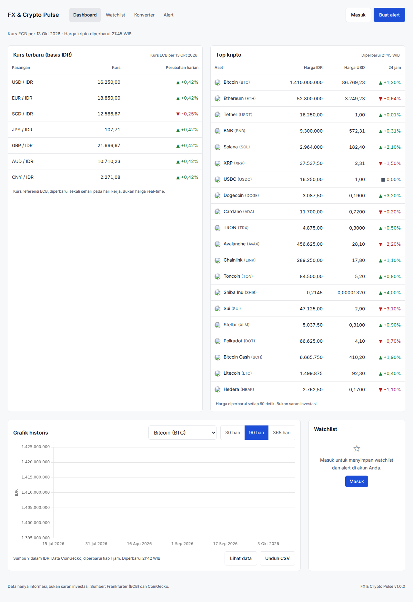
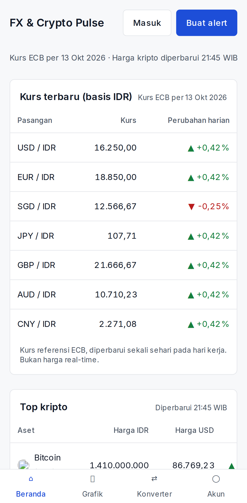

# FX & Crypto Pulse

[](https://github.com/danprasetyoo/FX-Crypto-Pulse/actions/workflows/ci.yml)
[](https://github.com/danprasetyoo/FX-Crypto-Pulse/actions/workflows/release.yml)

Dashboard kurs mata uang (referensi ECB via Frankfurter) dan harga kripto (CoinGecko) dengan grafik
historis 30/90/365 hari, konverter, watchlist per akun, dan alert harga via email. Dibangun dengan
cache agar tetap dalam batas rate limit API gratis. Data hanya informasi, bukan saran investasi.





## Fitur

| ID  | Fitur                                                                                  | Status |
| --- | -------------------------------------------------------------------------------------- | ------ |
| F1  | Kurs terbaru pasangan pilihan (basis IDR) dengan tanggal data ECB dan perubahan harian | ✅     |
| F2  | Top-20 kripto dalam IDR dan USD, perubahan 24 jam, waktu diperbarui                    | ✅     |
| F3  | Grafik historis 30/90/365 hari untuk FX dan kripto tanpa reload                        | ✅     |
| F4  | Alert harga di atas/di bawah target, email tepat sekali, nonaktif setelah terpicu      | ✅     |
| F5  | Konverter nominal antar mata uang dan kripto dengan waktu data                         | ✅     |
| F6  | Ekspor data grafik ke CSV (tanggal, nilai, rentang)                                    | ✅     |

Non-fungsional: cache 60 dtk (harga), 1 jam (histori, kurs); alert dievaluasi tiap 5 menit;
dashboard tetap tampil dari cache terakhir dengan label stale jika API down; tidak ada retry pada 429.

## Arsitektur

```
                 ┌──────────────────────────── gateway (nginx :8080) ────────────────────────────┐
Browser ───────► │ /api/fx /api/crypto /api/convert ─► market-service ─► Redis ─► Frankfurter/CoinGecko │
                 │ /api/auth /api/watchlist /api/alerts ─► user-service ─► PostgreSQL ─► SMTP            │
                 │ /  ─────────────────────────────► web (React SPA)                                     │
                 └────────────────────────────────────────────────────────────────────────────────────┘
                 alert-worker (BullMQ, tiap 5 menit) ─► market-service + PostgreSQL ─► SMTP (email alert)
```

| Komponen       | Teknologi                                                                    |
| -------------- | ---------------------------------------------------------------------------- |
| market-service | NestJS 11, ioredis, cache single-flight + stale fallback + cooldown 429      |
| user-service   | NestJS 11, PostgreSQL (`pg`), bcrypt, JWT cookie httpOnly 7 hari, nodemailer |
| alert-worker   | Node 22, BullMQ, pg, nodemailer                                              |
| web            | React 19, Vite, TanStack Query, Chart.js, token Design System (terang/gelap) |
| gateway        | nginx                                                                        |
| infra          | Docker Compose, GitHub Actions, GHCR                                         |

Rincian: [`docs/agents/architecture.md`](docs/agents/architecture.md). Panduan pengembangan untuk
manusia dan agen AI: [`AGENTS.md`](AGENTS.md). Spesifikasi produk: [`docs/`](docs/).

## Menjalankan dengan Docker (disarankan)

Prasyarat: Docker dengan Compose v2, Node 22 (hanya untuk e2e/lint).

```bash
cp .env.example .env            # sesuaikan bila perlu (COINGECKO_API_KEY opsional)
docker compose up -d --build --wait
# Aplikasi: http://localhost:8080   Mailpit (email dev): http://localhost:8025
```

Stack dev ini memanggil Frankfurter dan CoinGecko sungguhan. Untuk stack e2e dengan upstream
tiruan (deterministik, bisa disetel down/429/timeout):

```bash
npm ci
npm run stack:up                # compose + docker-compose.e2e.yml
npx playwright install chromium
npm run e2e                     # Playwright desktop + mobile
npm run stack:down
```

## Pengembangan lokal

```bash
npm ci
npm run lint && npm run typecheck && npm test && npm run build
```

- Frontend dev server: `npm run dev -w apps/web` (proxy `/api` ke `http://localhost:8080`).
- Tanpa Docker: `npm run build && npm i -D embedded-postgres && node scripts/local-stack.mjs`
  (butuh `valkey-server`/`redis-server`). Lihat [`docs/agents/testing.md`](docs/agents/testing.md).
- Uji beban: `k6 run -e BASE_URL=http://localhost:8080 load/k6/dashboard.js`
  (gerbang PRD: cache hit ≥ 90%, nol 429).

## API internal (ringkas)

Semua respons data berbentuk `{ data, updatedAt, source: "live"|"cache", stale: boolean }`.

| Metode                | Endpoint                                                                                                          | Akses         |
| --------------------- | ----------------------------------------------------------------------------------------------------------------- | ------------- |
| GET                   | `/api/fx/latest?base=IDR&quotes=USD,EUR,SGD`                                                                      | Tamu          |
| GET                   | `/api/fx/history?pair=USD-IDR&range=30`                                                                           | Tamu          |
| GET                   | `/api/crypto/top?vs=idr,usd`                                                                                      | Tamu          |
| GET                   | `/api/crypto/history?id=bitcoin&vs=idr&range=90`                                                                  | Tamu          |
| GET                   | `/api/convert?from=USD&to=IDR&amount=100`                                                                         | Tamu          |
| POST                  | `/api/auth/register`, `/api/auth/login`, `/api/auth/logout`, `/api/auth/reset-request`, `/api/auth/reset-confirm` | Tamu/Pengguna |
| GET                   | `/api/auth/me`                                                                                                    | Pengguna      |
| GET/POST/DELETE       | `/api/watchlist`, `/api/watchlist/:id`                                                                            | Pengguna      |
| GET/POST/PATCH/DELETE | `/api/alerts`, `/api/alerts/:id`                                                                                  | Pengguna      |
| GET                   | `/api/health/market`, `/api/health/user`, `/api/market/metrics`                                                   | Operator      |

## CI/CD

- **CI** (`.github/workflows/ci.yml`): format, lint, typecheck, unit test, build, build semua image
  Docker, lalu e2e Playwright terhadap stack compose. Berjalan di setiap push dan PR.
- **Release** (`release.yml`): tag `vX.Y.Z` → build & push image ke GHCR + GitHub Release dari `CHANGELOG.md`.
- **Deploy** (`deploy.yml`): setelah Release sukses atau manual → SSH ke server, `docker compose pull && up`.
  Atur secrets `DEPLOY_HOST`, `DEPLOY_USER`, `DEPLOY_SSH_KEY`, `DEPLOY_PATH`.

Rincian operasional: [`docs/agents/operations.md`](docs/agents/operations.md).

## Keamanan dan konfigurasi

- Rahasia hanya di `.env` (tidak di-commit) atau GitHub Secrets. Contoh lengkap di `.env.example`.
- Password di-hash bcrypt; sesi JWT di cookie httpOnly SameSite=Lax; token reset sekali pakai.
- Endpoint admin (`/api/market/cache/flush`, worker `/run`) hanya aktif lewat env dan dimatikan di produksi.

## Changelog

Lihat [CHANGELOG.md](CHANGELOG.md).
